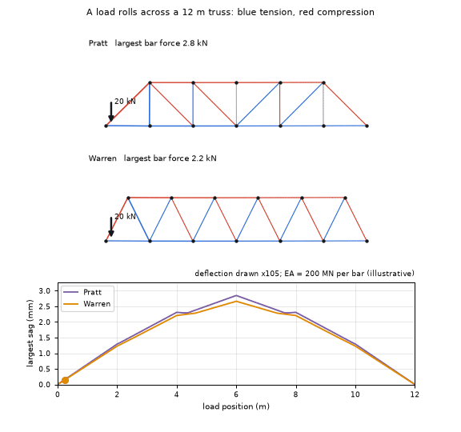
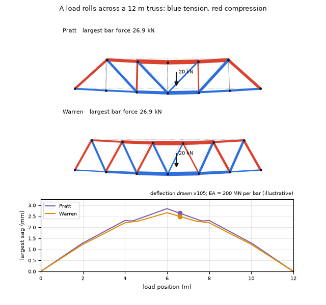
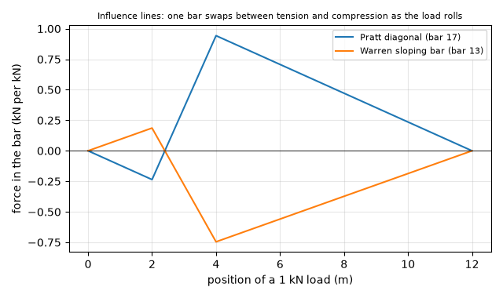
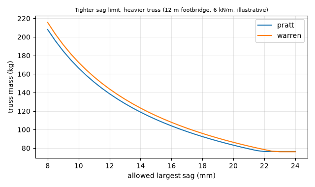

# What you are building toward

A 20 kN load rolls along the deck of a 12 m Pratt truss and a 12 m Warren truss. Every bar is coloured by its force (blue tension, red compression) with a width that follows the size of the force, and the deflected shape is exaggerated. A plot underneath tracks the midspan sag of both trusses as the load travels. Your goal over the coming sessions: build the solver behind it, then add moving loads, influence lines and buckling-aware sizing.

*Target: a load rolling across a Pratt and a Warren truss, bars coloured by force, deflection exaggerated*

*Target still: tension (blue), compression (red) and the sag of both trusses against load position*

*Target chart: influence lines show one bar swapping between tension and compression as the load rolls*

*Target chart: truss mass against the allowed sag for a 12 m footbridge (illustrative)*

These results come from a private reference build. The code is not published; the roadmap shows the path so you can build your own.

Live links:

- [Math Visual Studio: linear systems, the maths behind K u = f (Atlas S21)](https://krunalpanchal1995.github.io/studio/#atlas?ch=S21&ex=1)
- [Math Visual Studio: open the Studio (statics and structures are not yet an Atlas chapter with examples)](https://krunalpanchal1995.github.io/studio/)
