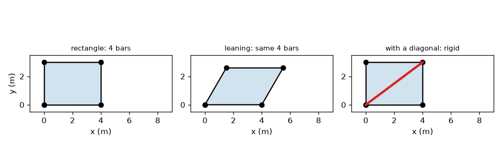
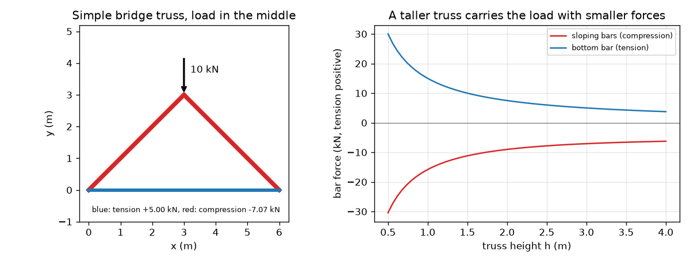

# Session 1: A triangle is rigid, and bars carry only tension or compression

*Level 1 (conceptual interactive model) · about 60 minutes · opentruss*

> This is a simplified educational model. It is not a validated design tool and must not be used for real structures, electrical installations, vehicles, industrial processes or medical decisions.

**Prerequisites**

- School trigonometry: sine, cosine, tangent.
- You have read PRIMER.md and run `python start.py 1` once.

**Learning objectives.** After this session you can:

- Explain why a triangle of pinned bars is rigid and a rectangle is not.
- Count the bars a rigid pin-jointed frame needs, 2 j - 3 for j joints.
- Find the forces in the simplest bridge truss from the balance of forces at one pin.
- Read a graph of bar force against truss height and say which bars are in tension and which in compression.

## A. Real-world problem
Look under a railway bridge or at a crane arm: you see straight bars joined into triangles. Why triangles and not rectangles? And when a heavy lorry stops in the middle of a small bridge, which bars are being pulled and which are being squashed? Engineers need to know, because a pulled bar and a squashed bar fail in different ways. This session builds the picture from the simplest truss. It is an educational model, not a design method.

## B. Concept and theory
A truss is a set of straight bars joined at pins; the loads act only at the pins. Then every bar is pulled or pushed along its own axis and nothing else. A bar that is pulled is in tension (we write its force as positive, drawn blue). A bar that is pushed is in compression (negative, drawn red). Four pinned bars forming a rectangle can lean over into a parallelogram with all bar lengths unchanged: the rectangle is a mechanism. A triangle cannot change its angles without changing a side, so it is rigid; a frame of j joints needs at least 2 j - 3 bars. For the simplest bridge truss (two equal sloping bars meeting at a loaded apex and a bottom bar joining the feet) the supports each carry P/2. Balance of the vertical forces at the apex gives 2 F sin(theta) = P, and balance of the horizontal forces at a foot gives the bottom-bar force.

| Symbol | Meaning | Unit |
|---|---|---|
| P | load at the apex | kN |
| L | span between the supports (6 m here) | m |
| h | height of the apex above the supports | m |
| theta | slope angle of the sloping bars | degrees |
| F_top | force in each sloping bar (negative = compression) | kN |
| F_bot | force in the bottom bar (positive = tension) | kN |
| j | number of joints (pins) | no unit |

**Assumptions**

- Bars are straight and weightless.
- Joints are frictionless pins and loads act only at the pins.
- The truss is small-deflection: its shape does not change when loaded.
- One pin support and one roller support, so there is no horizontal reaction.

$$ m_{\min}=2j-3\quad\text{(bars needed for a rigid frame of } j \text{ pins)} $$

$$ d^2=a^2+b^2-2ab\cos\varphi\quad\text{(diagonal of a pinned parallelogram)} $$

$$ \theta=\arctan\!\left(\frac{h}{L/2}\right) $$

$$ 2F_{\mathrm{top}}\sin\theta=-P\;\Rightarrow\;F_{\mathrm{top}}=-\frac{P}{2\sin\theta} $$

$$ F_{\mathrm{bot}}=\frac{P}{2\tan\theta} $$

## C. Visual explanation
The first figure shows a 4 m by 3 m rectangle of four bars, the same bars leaning over to a 60 degree corner (its diagonal shrinks from 5.0 m to 3.606 m), and the rectangle with a 5 m diagonal added, which allows only the 90 degree shape. The second figure draws the simple bridge with a 10 kN load at the apex, with the sloping bars red and the bottom bar blue, and plots the two forces against the height h: both fall as the truss gets taller.

*A rectangle leans (same four bars); a diagonal makes it rigid.*

*A simple bridge truss with a 10 kN load, and its bar forces against height.*

## D. Interactive simulation
Run the lesson (`python start.py 1`), then open the live app: [Session 1: a simple bridge truss](https://krunalpanchal1995.github.io/opentruss/session-01/) (or `app.html` in this folder). Move the height slider and watch the bars change width: the flatter the truss, the harder every bar works. Switch to the graph view to see the two force curves and your current point on them.

**Challenge.** Carry a load of at least 10 kN while keeping the bottom-bar tension below 5 kN.

## E. Worked example and experiment
**Problem.** A small bridge truss spans 6 m. The apex is 3 m high and carries 10 kN. Find the force in each bar and say whether it is in tension or compression.

1. Supports: by symmetry each carries 10 / 2 = 5 kN upwards.
2. Slope angle: theta = arctan(3 / 3) = 45 degrees, so sin(theta) = 0.7071 and tan(theta) = 1.
3. Apex pin, sum of vertical forces = 0: 2 F sin(45) = 10, so the size of each sloping force is 10 / (2 * 0.7071) = 7.07 kN. The bars push on the apex, so they are in compression: F_top = -7.07 kN.
4. Left foot pin, sum of horizontal forces = 0: the sloping bar pushes the foot outwards with 7.07 * cos(45) = 5.00 kN, so the bottom bar must pull it back with 5.00 kN: F_bot = +5.00 kN (tension).
5. Check the vertical balance at the foot: 7.07 * sin(45) = 5.00 kN, equal to the 5 kN reaction.

**Answer.** The two sloping bars carry -7.07 kN (compression) and the bottom bar carries +5.00 kN (tension).

**Experiment.** Make the truss from three wooden rulers pinned with paper fasteners, rest it on two books and hang a bag of known mass from the apex. Replace the bottom ruler by a spring balance or a rubber band: it stretches, so it is in tension. Press on the apex and the two rulers shorten slightly, so they are in compression. Differences from the model: real joints have friction and are not exactly pins, rulers have weight, and the books can shift outwards, so the bottom bar force you measure will be somewhat lower or higher than 5.00 kN per 10 kN.

## F. Assessment and design challenge
**Question type A: Conceptual.** Why does adding one diagonal make a rectangle of pinned bars rigid, and why does the rectangle without it fail? Use the numbers of the 4 m by 3 m rectangle.

Hint

Compare the length of the diagonal at the 90 degree corner and at a leaning 60 degree corner.

Step-by-step solution

Without a diagonal, the four bar lengths stay the same when the frame leans, so nothing stops it: it is a mechanism. When it leans from 90 to 60 degrees, the distance between opposite corners changes from 5.0 m to 3.606 m. A fixed 5 m bar fixes that distance, and by the law of cosines only the 90 degree corner gives 5 m, so the frame can no longer move. A frame with 4 joints needs 2*4 - 3 = 5 bars, and the rectangle has only 4.

**Question type B: Numerical.** A truss of span 6 m and height 1.5 m carries 12 kN at its apex. Find the force in the sloping bars and in the bottom bar, with signs.

Hint

tan(theta) = 1.5 / 3 = 0.5, so sin(theta) = 0.4472.

Step-by-step solution

F_top = -12 / (2 * 0.4472) = -13.42 kN (compression). F_bot = 12 / (2 * 0.5) = +12.00 kN (tension). Check: the sloping bar's vertical part is 13.42 * 0.4472 = 6.0 kN, which is half the load. Units: kN.

**Question type C: Graph and simulation interpretation.** On the force against height graph (10 kN load), what happens to the forces as the truss is made taller, from 0.5 m to 4 m? Give the forces at both ends.

Hint

Read the red and blue curves at h = 0.5 and h = 4.

Step-by-step solution

Both curves fall as h grows. At h = 0.5 m the bars carry -30.41 kN and +30.00 kN, three times the 10 kN load. At h = 4 m they carry -6.25 kN and +3.75 kN. A flat truss is almost a straight cable-and-strut that must resist the load at a shallow angle, so the forces are huge.

**Question type D: Design and optimisation challenge.** Design: choose the smallest height (to the nearest 0.25 m) so that the bottom bar's tension is at most 4 kN under a 10 kN load on a 6 m span. What compression does each sloping bar then carry, and what do you give up?

Hint

F_bot = P / (2 tan theta) = P * 3 / (2 h).

Step-by-step solution

F_bot = 10 * 3 / (2 h) = 15 / h <= 4 gives h >= 3.75 m. At h = 3.75 m the slope is 51.3 degrees, the bottom bar has exactly +4.00 kN and each sloping bar -6.40 kN. Trade-off: a taller truss reduces the forces but needs longer bars, more height clearance and more bracing against sideways wind, and long compression bars are more prone to buckling.

Score yourself with [RUBRIC.md](../../RUBRIC.md). Print the [activity sheet](activity_sheet.md) to work on paper.

## Common misconceptions
| Common misconception | What is actually true |
|---|---|
| A rectangle made of strong bars is rigid. | Four bars joined by pins can lean over however strong they are; only a triangle (or a frame braced into triangles) holds its shape. |
| Every bar in a bridge is pulled. | In a truss some bars are pulled (tension) and some are pushed (compression); the sign of the force tells which. |
| A taller truss needs more steel in every bar. | For a given load, taller trusses have smaller bar forces (the bars are longer, though, so total steel is a trade-off). |
| A bar in a truss bends like a beam. | With loads only at pins, a bar carries only a force along its own axis; bending is outside this model. |

## Glossary
- **truss**: a set of straight bars joined at pins, loaded only at the pins
- **tension**: a pulling force along a bar; positive in this repo, drawn blue
- **compression**: a pushing force along a bar; negative in this repo, drawn red
- **pin**: a frictionless joint that lets bars turn but passes force
- **mechanism**: a frame that can move without any bar changing length
- **reaction**: the force a support pushes back with

## Finish
1. Do the three coding tasks in [exercises.md](exercises.md).
2. Run `python start.py 1` again after your changes. It ends with the checkpoint; when it prints `PASS`, you are done. (Checkpoint only: `python start.py check 1`.)

Next: [Session 2](../session-02/README.md)
