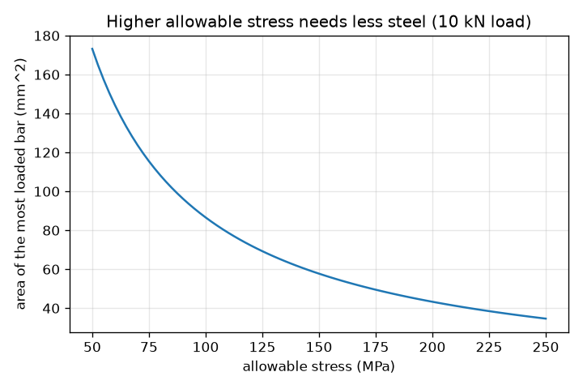
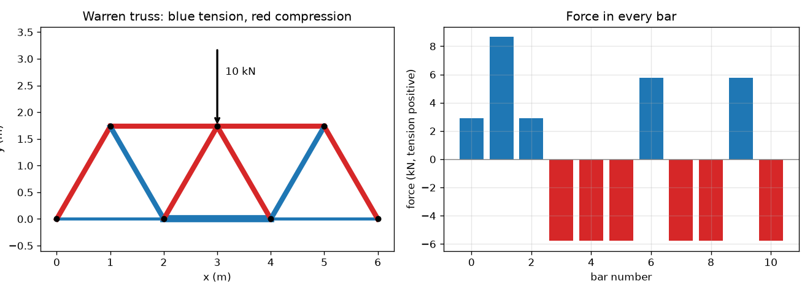

# Session 2: Equilibrium of every pin: the method of joints and sections

*Level 2 (mathematical engineering model) · about 75 minutes · opentruss*

> This is a simplified educational model. It is not a validated design tool and must not be used for real structures, electrical installations, vehicles, industrial processes or medical decisions.

**Prerequisites**

- Session 1: bars carry tension and compression.
- Sum of forces in x and y; solving a small linear system (explained in Section B).

**Learning objectives.** After this session you can:

- Decide whether a truss is determinate from m + r = 2 j.
- Write sum Fx = 0 and sum Fy = 0 for each pin and solve for all bar forces and reactions.
- Use the method of sections to check one bar force without solving the whole truss.
- Choose bar areas for a stress limit and name the buckling concern for compression bars.

## A. Real-world problem
A 6 m footbridge truss carries a 10 kN load at midspan. Before any steel is cut, someone must know the force in every bar: which are pulled, which are pushed, and how big. The answer decides the size of each bar. The same pin-by-pin reasoning works for a three-bar wall bracket and for a bridge with eleven bars. This is a simplified teaching model with ideal pins and weightless bars; it is not a design method.

## B. Concept and theory
Take one pin. Every bar at the pin pulls on it along the bar's axis (a bar in tension pulls the pin towards the bar's other end). The pin is at rest, so the forces on it add to zero: sum Fx = 0 and sum Fy = 0. That is 2 equations per joint, so a truss with j joints gives 2 j equations. The unknowns are the m bar forces and the r support reactions. If m + r = 2 j the truss is statically determinate and the equations have exactly one solution; if m + r < 2 j it is a mechanism; if m + r > 2 j it has redundant bars and statics alone is not enough. The code writes the 2 j equations as one linear system and solves it. The method of sections cuts the truss in two and balances one piece: moments about the point where two cut bars meet remove their forces and leave the third. Stress is force over area, sigma = F / A, so a stress limit sigma_allow fixes the smallest area A = |F| / sigma_allow. A compression bar can also buckle (bend sideways) before it reaches that stress, so compression bars are made thicker in practice; Session 3 checks one case.

| Symbol | Meaning | Unit |
|---|---|---|
| m | number of bars | no unit |
| r | number of support reactions (pin = 2, roller = 1) | no unit |
| j | number of joints | no unit |
| F | bar force (tension positive) | kN |
| R | support reaction | kN |
| h | height of the Warren truss (side * sqrt(3) / 2) | m |
| sigma | stress in a bar, F / A | MPa (N/mm^2) |
| A | cross-section area of a bar | mm^2 |

**Assumptions**

- Ideal pins and weightless straight bars; loads only at joints.
- A pin support and a roller support, both on the ground line.
- Small deflections: the shape is taken as undeformed.
- Equal stress limit of 150 MPa for tension and compression (illustrative only).

$$ m+r=2j\quad\text{(statically determinate)} $$

$$ \sum F_x=0,\qquad \sum F_y=0\quad\text{at every pin} $$

$$ \begin{pmatrix}F_x\\F_y\end{pmatrix}_{\text{on pin}}=F\,(\cos\alpha,\ \sin\alpha)\quad\text{(tension pulls towards the other end)} $$

$$ F_{\mathrm{bottom}}\,h=R\cdot 3,\qquad F_{\mathrm{top}}\,h=-R\cdot 2\quad\text{(sections, moments about the joints at }x=3\text{ and }x=2\text{)} $$

$$ A=\frac{|F|}{\sigma_{\mathrm{allow}}} $$

## C. Visual explanation
The first figure shows the 6 m Warren truss with the 10 kN load on the top joint at midspan: red top chord and red sloping bars on the load side, blue bottom chord and blue sloping bars on the other. Next to it a bar chart lists the force in all 11 bars. The second figure plots the area the most loaded bar needs against the allowable stress: the area falls as the limit rises.

*Area needed by the most loaded bar against the allowable stress.*

*Warren truss with a 10 kN midspan load: blue tension, red compression, and the force in every bar.*

## D. Interactive simulation
Run the lesson (`python start.py 2`), then open the live app: [Session 2: a Warren truss under a midspan load](https://krunalpanchal1995.github.io/opentruss/session-02/) (or `app.html` in this folder). Change the load and the bar area and watch the stress chart: each bar's stress is its force divided by the area. The red lines mark the 150 MPa limit.

**Challenge.** Carry a load of at least 20 kN with every bar within 150 MPa.

## E. Worked example and experiment
**Problem.** A Warren truss spans 6 m with bottom joints every 2 m and equilateral triangles of side 2 m (height 1.732 m): 7 joints, 11 bars, a pin and a roller. A 10 kN load acts down at the top joint at midspan. Find the forces by joints, check one by sections, and size the most loaded bar for 150 MPa.

1. Determinacy: m + r = 11 + 3 = 14 = 2 j = 14, so statics is enough.
2. Reactions: by symmetry 5 kN up at each foot, no horizontal reaction.
3. Left foot pin: the bar rising at 60 degrees gives F sin(60) + 5 = 0, so F = -5 / 0.866 = -5.77 kN (compression). Horizontal: -5.77 cos(60) + F_bottom = 0 gives the first bottom bar +2.89 kN.
4. Next pin, the top joint above x = 1 m: the sloping bar going down to x = 2 m must carry +5.77 kN (tension) and the top chord -5.77 kN (compression). Continue pin by pin: every sloping bar is plus or minus 5.77 kN, the top chords -5.77 kN, and the middle bottom chord +8.66 kN.
5. Check by sections: cut at x = 2.5 m. Moments about the top joint at x = 3 m: F_bottom * 1.732 = 5 * 3, so F_bottom = +8.66 kN. Moments about the bottom joint at x = 2 m: F_top * 1.732 = -5 * 2, so F_top = -5.77 kN. Both agree with the joints.
6. Size the most loaded bar (8.66 kN) for 150 MPa: A = 1000 * 8.66 / 150 = 57.7 mm^2.

**Answer.** Sloping bars +-5.77 kN, top chord -5.77 kN, bottom chord +2.89, +8.66, +2.89 kN; the most loaded bar needs 57.7 mm^2 at 150 MPa. Five bars are in tension and six in compression.

**Experiment.** Build the Warren truss from drinking straws joined by pins or from a kit with stiff rods, put it on two supports and hang a known mass at the midspan top joint. Replace the middle bottom bar by a spring balance (tension 8.66 kN per 10 kN load in the model, so 0.866 N per 1 N load). Differences: real joints carry bending and friction, the straws have weight, and the supports are not exactly a pin and a roller; also, the model ignores the buckling that makes slim compression bars fail early.

## F. Assessment and design challenge
**Question type A: Conceptual.** A truss has 12 joints, 21 bars and 3 support reactions. Is it determinate? What would you expect if one bar were removed, and what if one were added?

Hint

Compare m + r with 2 j.

Step-by-step solution

m + r = 24 = 2 j = 24, so it is determinate. Remove a bar: m + r = 23 < 24, so there are fewer unknowns than equations: the truss is a mechanism and can move (or is not in equilibrium for every load). Add a bar: m + r = 25 > 24, so it is statically indeterminate and statics alone cannot give the forces; stiffness is needed (Session 3).

**Question type B: Numerical.** Double the Warren load to 20 kN. Find the sloping bar forces and the middle bottom chord, and the area the chord needs at 150 MPa. Then round the areas up to 120 mm^2 for the chord and 80 mm^2 for the sloping bars: what are the stresses?

Hint

The truss is linear: every force doubles.

Step-by-step solution

Sloping bars: +-11.55 kN; middle bottom chord +17.32 kN. Chord area: 1000 * 17.32 / 150 = 115.5 mm^2; sloping bars: 1000 * 11.55 / 150 = 77.0 mm^2. With 120 mm^2 the chord stress is 17.32 * 1000 / 120 = 144.3 MPa and with 80 mm^2 the sloping bars have 11.55 * 1000 / 80 = 144.3 MPa, both below 150 MPa. Sanity check: forces doubled when the load doubled.

**Question type C: Graph and simulation interpretation.** In the bar chart of the Warren truss, how many bars are in tension, how many in compression, and which group is the top chord in? Which bar has the largest force?

Hint

Blue bars point up (positive), red bars point down.

Step-by-step solution

Five bars are in tension (the three bottom-chord bars and two sloping bars) and six in compression (the two top-chord bars and four sloping bars). The top chord is in compression. The largest force is the middle bottom chord, +8.66 kN, because the bending-like effect of the load is largest at midspan.

**Question type D: Design and optimisation challenge.** Design: for the 20 kN load use bars of 120 mm^2 for the chord and 80 mm^2 for the other 10 bars, against 120 mm^2 for all 11 bars. Compare the steel volumes (all bars 2 m long) and say what the buckling concern changes.

Hint

Volume = area * length, summed over bars; each bar is 2 m.

Step-by-step solution

One size: 120 * 2 * 11 = 2640 mm^2 m. Two sizes: 120 * 2 + 80 * 2 * 10 = 1840 mm^2 m, a saving of 30 percent. The saving assumes tension and compression bars are equally strong per area; compression bars can buckle at lower stresses, so in a real design they would be made larger (or as tubes) and the saving would be smaller. This model does not check buckling.

Score yourself with [RUBRIC.md](../../RUBRIC.md). Print the [activity sheet](activity_sheet.md) to work on paper.

## Common misconceptions
| Common misconception | What is actually true |
|---|---|
| The load at midspan travels straight down the nearest bar. | Force spreads through the whole truss; each pin balances the bars that meet there, so bars far from the load carry force too. |
| A bar's force sign depends on whether it is horizontal or sloping. | The sign depends only on whether the bar is pulled (positive) or pushed (negative) by the pins. |
| If m + r = 2 j the truss must be stable. | The count is necessary, not sufficient: bars can be arranged badly (for example a bar missing in one panel and a doubled bar in another), giving a singular system. |
| Smaller stress than the limit means the bar is safe. | A compression bar can buckle at a much lower stress. The stress check alone is incomplete. |

## Glossary
- **determinate**: m + r = 2 j: statics alone gives every force
- **method of joints**: balance forces at each pin in turn
- **method of sections**: cut the truss and balance one piece, using moments
- **chord**: the top or bottom line of bars of a truss
- **stress**: force per unit area, sigma = F / A
- **buckling**: sideways bending failure of a slim compression bar

## Finish
1. Do the three coding tasks in [exercises.md](exercises.md).
2. Run `python start.py 2` again after your changes. It ends with the checkpoint; when it prints `PASS`, you are done. (Checkpoint only: `python start.py check 2`.)

Next: [Session 3](../session-03/README.md)
