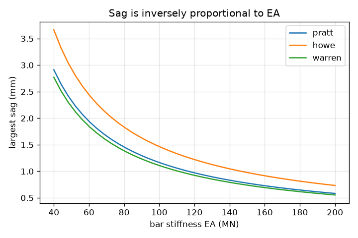
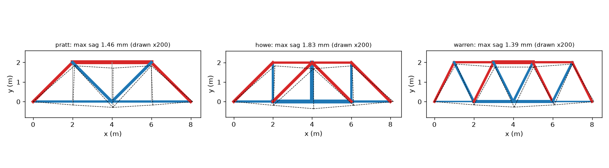

# Session 3: A stiffness solver for any truss, validated

*Level 3 (simulation and validation) · about 90 minutes · opentruss*

> This is a simplified educational model. It is not a validated design tool and must not be used for real structures, electrical installations, vehicles, industrial processes or medical decisions.

**Prerequisites**

- Session 1 and Session 2.
- Matrix times vector and solving K u = f (explained in Section B; Atlas S21 on linear systems helps).

**Learning objectives.** After this session you can:

- Assemble the global stiffness matrix of any 2D pin-jointed truss from EA/L and direction cosines.
- Apply supports, solve K u = f and recover bar forces and joint deflections.
- Validate the solver with hand results, joint equilibrium and a virtual-work formula.
- Compare Pratt, Howe and Warren shapes, and detect a mechanism from the rank or condition number.

## A. Real-world problem
Statics (Session 2) breaks down when a truss has extra bars, and it says nothing about how far a bridge sags. A footbridge must be strong and stiff, so engineers use the direct stiffness method: every bar is a spring, and one matrix equation K u = f gives all the deflections and forces. Which bar shape sags least? What happens when one bar is missing? When does a slim compression bar buckle? This is a simplified educational solver: ideal pins, small deflections, never for real structures.

## B. Concept and theory
A bar from joint i to joint k, of length L and axial stiffness EA/L, resists changes of length. If c = cos(angle) and s = sin(angle) are the direction cosines of the bar, it adds a 4 by 4 block (EA/L) [[C, -C], [-C, C]] to the global matrix K, where C = [[c c, c s], [c s, s s]]. Assembling all bars gives K, which relates joint displacements u to joint forces f. Supports remove degrees of freedom: we keep the free ones, solve K_ff u_f = f_f, then recover each bar force as F = (EA/L) (u_k - u_i) . (c, s) with tension positive. A mechanism has a singular K_ff (some motion costs no energy), which shows as a rank smaller than the number of free degrees of freedom, or a huge condition number. For deflection checks, the unit-load (virtual work) formula says delta = sum of F f L / EA over all bars, where f are the bar forces for a unit load at the joint where the deflection is wanted. A compression bar can buckle: the Euler load of a pin-ended column is P_cr = pi^2 E I / L^2, used here only as a check. For a determinate truss, bar forces do not depend on EA, and deflections are proportional to 1/EA; for an indeterminate truss, forces depend on the relative stiffness.

| Symbol | Meaning | Unit |
|---|---|---|
| E | Young's modulus (steel, 200 GPa) | GPa |
| A | bar cross-section area | mm^2 |
| EA | axial stiffness of a bar (E in GPa times A in mm^2) | kN |
| L | bar length | m |
| K | global stiffness matrix | kN/m |
| u | joint displacement vector | m |
| f | joint load vector | kN |
| I | second moment of area of a bar section | m^4 |
| P_cr | Euler buckling load | kN |

**Assumptions**

- Ideal pins, straight weightless bars, loads only at joints.
- Small deflections: K is built from the undeformed shape.
- Linear elastic material: forces and displacements are proportional to the load.
- For buckling, bars are pin-ended solid round bars (illustrative); the check is Euler only and ignores imperfections.
- Educational model; never use it for a real structure.

$$ k_e=\frac{EA}{L}\begin{pmatrix}C&-C\\-C&C\end{pmatrix},\quad C=\begin{pmatrix}c^2&cs\\cs&s^2\end{pmatrix} $$

$$ K\,u=f\;\Rightarrow\;K_{ff}\,u_f=f_f $$

$$ F_e=\frac{EA}{L}\,(u_k-u_i)\cdot(c,\ s) $$

$$ \delta=\sum_e \frac{F_e\,f_e\,L_e}{(EA)_e}\quad\text{(unit-load method)} $$

$$ P_{cr}=\frac{\pi^2 E I}{L^2},\qquad I=\frac{A^2}{4\pi}\ \text{(solid round bar)} $$

## C. Visual explanation
The first figure draws the Pratt, Howe and Warren trusses (8 m span, 2 m high, 10 kN at midspan), coloured by force with the deflection drawn 200 times too large. Pratt diagonals are blue (tension) and Howe diagonals are red (compression). The second figure plots the largest sag against the bar stiffness EA for the three shapes: three falling curves, each proportional to 1/EA.

*Largest sag against bar stiffness EA for the three shapes (inverse proportion).*

*Pratt, Howe and Warren under 10 kN at midspan: colour is force, deflection drawn 200 times larger.*

## D. Interactive simulation
Run the lesson (`python start.py 3`), then open the live app: [Session 3: Pratt, Howe and Warren under the same load](https://krunalpanchal1995.github.io/opentruss/session-03/) (or `app.html` in this folder). Pick a shape tab, change the load and the bar stiffness, and watch the colours and the sag. Open the sag graph to compare the three shapes against EA.

**Challenge.** Make the Pratt truss sag by no more than 2 mm under a load of at least 20 kN.

## E. Worked example and experiment
**Problem.** For the 8 m Pratt truss (4 panels of 2 m, height 2 m, EA = 80 000 kN for every bar, 10 kN at midspan) find the midspan sag by the unit-load method and compare it with the solver.

1. Forces for 10 kN (statics): bottom chords +5 kN (4 bars, 2 m), top chords -10 kN (2 bars, 2 m), end posts -7.07 kN and diagonals +7.07 kN (4 bars of 2.83 m), verticals 0.
2. A unit load at midspan gives forces equal to these divided by 10, so F f = F^2 / 10.
3. Sum of F^2 L: bottom 4 * 25 * 2 = 200; top 2 * 100 * 2 = 400; end posts 2 * 50 * 2.828 = 282.84; diagonals 2 * 50 * 2.828 = 282.84; total 1165.69 kN^2 m.
4. Deflection: delta = 1165.69 / 10 / 80 000 = 0.001457 m = 1.457 mm.
5. The stiffness solver gives the same 1.457 mm at midspan. Doubling the EA of one bottom bar only lowers it to 1.426 mm and changes no force.

**Answer.** The Pratt truss sags 1.457 mm at midspan by both methods; Howe sags 1.832 mm and Warren 1.386 mm under the same load.

**Experiment.** Build the three trusses from stiff rods or cardboard strips with pins, support them over a 0.8 m gap and hang the same mass from the middle bottom joint; measure the sag with a ruler or a phone camera. Expect Warren and Pratt to sag less than Howe in the same order as the model, but not the exact sizes: real pins have clearance, the joints are stiff in bending, the bars have different stiffness and the deflections are tiny, so measurement error is large compared with the 1 to 2 mm of the model.

## Real-world application and mini-project: Pick the lightest truss for a 12 m footbridge
A small footbridge spans 12 m with six panels of 2 m and a height of 2 m. The deck load is 6 kN/m, shared between the deck joints. Steel (E = 200 GPa, density 7850 kg/m^3) may be stressed to 150 MPa, no bar may be thinner than 100 mm^2, and the largest sag must not exceed 15 mm. Using `footbridge_case` and `size_truss` from Session 3, size a Pratt, a Howe and a Warren truss and choose the lightest. All numbers are illustrative; this is a teaching exercise, never a design for a real bridge.

**Deliverable:** A script that prints, for each shape, the bar count, the mass and sag when sized for stress only, and the mass and sag when the 15 mm limit is enforced, names the lightest shape, and saves a bar chart of the masses.

**Success looks like:** The stress-only designs sag 21.8 mm (Pratt), 25.4 mm (Howe) and 22.7 mm (Warren), all above the limit; with the limit enforced the masses are 111 kg, 136 kg and 115 kg, every sag is 15.0 mm, and the Pratt truss is reported as the lightest.

## F. Assessment and design challenge
**Question type A: Conceptual.** In the Pratt truss the diagonals are in tension and in the Howe truss they are in compression, although both carry the same load. Why does it matter for the design which bars are pulled?

Hint

Think about which failure a slim bar suffers in tension and which in compression.

Step-by-step solution

A bar in tension fails only when its stress reaches the material limit, so a thin bar is fine. A bar in compression can buckle at a much lower force (Euler: P_cr falls with the square of its length). The Pratt shape puts the long diagonals in tension and the short verticals in compression (here they carry zero under the midspan load), so it is usually the sounder choice for steel; Howe puts the long diagonals in compression.

**Question type B: Numerical.** Use the unit-load method for the three-bar triangle truss (span 6 m, height 3 m, 10 kN at the apex, EA = 80 000 kN). Give the apex sag in mm, then check with the solver.

Hint

Forces: -7.07, -7.07 and +5.00 kN; unit-load forces are one tenth of these; the sloping bars are 4.243 m long, the bottom bar 6 m.

Step-by-step solution

Sum F f L / EA = (2 * 7.07 * 0.707 * 4.243 + 5 * 0.5 * 6) / 80 000 = (42.43 + 15) / 80 000 = 0.000718 m = 0.718 mm. The solver gives the same 0.718 mm downwards.

**Question type C: Graph and simulation interpretation.** On the sag against EA graph, why are the three curves hyperbolas (proportional to 1/EA), and what does that tell you about doubling the steel area?

Hint

Look at the formula delta = sum F f L / EA for a determinate truss.

Step-by-step solution

The forces F and f do not depend on EA in a determinate truss, so delta is a constant divided by EA: doubling every bar's area halves the sag. The curves are ordered Howe above Pratt above Warren, and they never cross. The bar forces do not change: stiffness only moves the deflection.

**Question type D: Design and optimisation challenge.** Design: the 12 m footbridge (6 panels, 2 m high, 6 kN/m) is sized by stress alone (150 MPa, 100 mm^2 minimum). The sag limit is 15 mm. For each shape say whether the stress-only design passes, and what the lightest shape is when the limit is enforced by scaling all areas up together.

Hint

Use `footbridge_case` and `size_truss` with `limit_mm=15.0`.

Step-by-step solution

Stress-only designs sag 21.8 mm (Pratt), 25.4 mm (Howe) and 22.7 mm (Warren): all fail. Scaling the areas up by 1.45, 1.69 and 1.51 gives sags of exactly 15.0 mm, with masses 111 kg (Pratt), 136 kg (Howe) and 115 kg (Warren): the Pratt truss is lightest. Assumptions: uniform scale-up (not optimal sizing), 7850 kg/m^3 steel, no buckling check, illustrative numbers.

Score yourself with [RUBRIC.md](../../RUBRIC.md). Print the [activity sheet](activity_sheet.md) to work on paper.

## Common misconceptions
| Common misconception | What is actually true |
|---|---|
| A singular K means the code has a bug. | A singular K_ff is the correct answer for a mechanism: the truss really can move. A missing bar or too few supports causes it. |
| A stiffer material changes the bar forces in any truss. | In a determinate truss the forces come from statics alone; stiffness changes the deflection. Only in an indeterminate truss do forces depend on relative stiffness. |
| If the stress is within the limit the bar is fine. | A solid round bar sized for 10 kN at 150 MPa, 2 m long, has an Euler buckling load of only 0.175 kN, so it would buckle long before the stress limit. |
| More bars always means a lighter bridge. | The Warren truss has 15 bars against 13 for Pratt and Howe, yet its sag is lower and in the footbridge it is not the lightest; the answer depends on the load and the limits. |

## Glossary
- **stiffness matrix**: K, the matrix that turns joint displacements into joint forces
- **degree of freedom**: one independent motion of a joint (x or y)
- **direction cosines**: cos and sin of the angle of a bar, written c and s
- **mechanism**: a structure that can move without stretching any bar; K_ff is singular
- **virtual work**: a deflection formula: sum of F f L / EA with unit-load forces f
- **Euler load**: P_cr = pi^2 E I / L^2, the buckling load of a slim pin-ended column
- **condition number**: a measure of how close a matrix is to singular; huge means nearly singular

## Finish
1. Do the three coding tasks in [exercises.md](exercises.md).
2. Run `python start.py 3` again after your changes. It ends with the checkpoint; when it prints `PASS`, you are done. (Checkpoint only: `python start.py check 3`.)

Next: the [roadmap](../../promo/roadmap.md). Session 4 is yours to build.
